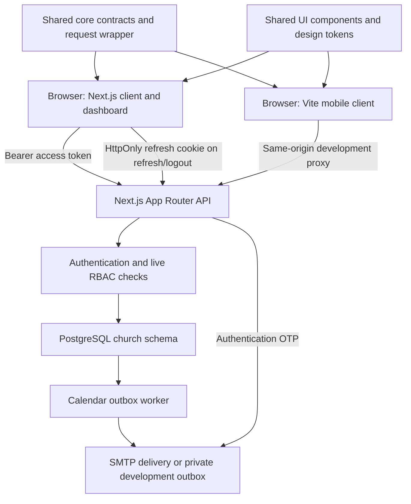

# Church Member Management

A Vietnamese church member directory with a mobile-oriented client, an administrative dashboard, PostgreSQL persistence, department-scoped permissions, OTP onboarding, persistent authentication, and duplicate-profile merging.

This README is the project handoff and review entry point. It describes the implementation as of **6 November 2026**, including its operating requirements and known limits. It contains no administrator password, SMTP password, connection secret, or member export.

## Contents

- [Project scope and implementation status](#project-scope-and-implementation-status)
- [Architecture](#architecture)
- [Technology stack](#technology-stack)
- [Repository structure](#repository-structure)
- [Member-facing features](#member-facing-features)
- [Administrative features](#administrative-features)
- [Calendar, event email and Word export](#calendar-event-email-and-word-export)
- [Roles, permissions, and privacy](#roles-permissions-and-privacy)
- [Authentication and persistent sessions](#authentication-and-persistent-sessions)
- [Database model and migrations](#database-model-and-migrations)
- [Local development](#local-development)
- [Environment configuration](#environment-configuration)
- [Importing local test data](#importing-local-test-data)
- [Pages and API reference](#pages-and-api-reference)
- [Development commands and verification](#development-commands-and-verification)
- [Deployment and operations](#deployment-and-operations)
- [Backup, archival, and handoff](#backup-archival-and-handoff)
- [Reviewer guide and remaining work](#reviewer-guide-and-remaining-work)
- [Troubleshooting](#troubleshooting)
- [Supporting documentation](#supporting-documentation)

## Project scope and implementation status

The **live application serves a single church**. There is no live organization table, organization switcher, tenant onboarding, billing service, or multi-tenant security boundary. Departments, called **Ban ngành**, are the primary grouping and management-scope mechanism.

The repository originated as an organization-management demonstration. Shared names such as `organizationId`, `workspaceKey`, `Membership`, and the `@org/*` package prefix remain in adapters and contracts. They do not establish tenant isolation. A historical schema is retained at [database/legacy/001_multitenant_demo.sql](database/legacy/001_multitenant_demo.sql); do not apply it to the live church database.

| Capability                                                        | Current implementation                                                               |
| ----------------------------------------------------------------- | ------------------------------------------------------------------------------------ |
| Member directory, profile editing, departments, households        | PostgreSQL-backed, with server authorization                                         |
| Role assignment and permission configuration                      | PostgreSQL-backed; Admin/Thư ký management interface                                 |
| Password login, phone OTP, email OTP, first-password setup        | Implemented in Next.js API routes                                                    |
| Persistent login, rotating refresh credentials, logout/revocation | Implemented; access tokens remain in memory                                          |
| Admin OTP overview and phone-OTP email notification               | Implemented; Admin-only OTP visibility                                               |
| Notes and visit history                                           | Persisted, with self-history and role restrictions                                   |
| Profile merging                                                   | Transactional Admin-only preview/confirmation flow                                   |
| Dashboard activity                                                | Reads persisted audit events; the workspace response limits recent events            |
| Tasks, check-ins, general notifications, billing                  | Original scaffold/demo concepts; not complete live services                          |
| Calendar and event email                                          | Month/week/day calendar, email groups, durable delivery outbox, editable Word export |
| Offline/PWA operation                                             | Mobile viewport/manifest groundwork; no authenticated offline data cache             |
| Multi-tenancy                                                     | Historical demonstration only                                                        |

Some dashboard components still contain English labels or presentation inherited from the original scaffold. The member flows and newer management/authentication screens use Vietnamese. Dashboard charts and task-related cards should not be presented as validated operational analytics; the live workspace currently returns an empty task collection.

## Architecture

The repository is an **npm workspaces monorepo** with two applications and two shared packages.



### Applications and request flow

- **`apps/web-admin`** runs Next.js App Router, API endpoints, the dashboard, and the mobile experience at `/client`. This is the main integrated application.
- **`apps/mobile-client`** runs the mobile client independently through Vite. In development, its proxy forwards API and Next.js navigation requests to the backend on port 3000.
- **`packages/core`** supplies Zod contracts, catalogs, name/age helpers, authentication state, typed requests, query logic, and the explicit legacy demo adapter.
- **`packages/ui`** supplies owned shadcn-style/Radix components and shared design tokens.

After a login or refresh, the browser keeps its short-lived access credential in module memory and sends it using `Authorization: Bearer …`. PostgreSQL stores the access-session hash and refresh-token hashes. The refresh cookie cannot authorize member APIs by itself.

Pages render public UI shells. Authentication is restored in the client before protected content is displayed, and sensitive data comes from authenticated APIs. A page returning HTML with HTTP 200 is therefore not evidence that its member data is publicly accessible. Every API must independently enforce its permission and record scope.

Mutations use transactions and parameterized SQL. Important authentication, role, and member writes share a PostgreSQL advisory transaction lock. Profile versions and merge preview tokens protect against stale changes. PostgreSQL notifications feed the authorized OTP stream; the client uses fetch-based SSE so the bearer credential stays out of URLs.

## Technology stack

The exact dependency resolution is in [package-lock.json](package-lock.json). Major technologies in the current workspace are:

| Area                     | Technology                                                                      |
| ------------------------ | ------------------------------------------------------------------------------- |
| Client rendering         | React 19, TypeScript                                                            |
| Mobile development/build | Vite 6                                                                          |
| Backend and dashboard    | Next.js App Router 16, Node.js route handlers                                   |
| Styling                  | Tailwind CSS 4, semantic CSS variables, shared light/dark tokens                |
| Components               | Owned shadcn-style components using Radix primitives                            |
| Server state and tables  | TanStack React Query 5, TanStack Table 8                                        |
| UI state                 | Zustand                                                                         |
| Forms and validation     | React Hook Form, Zod 4                                                          |
| Database                 | PostgreSQL, `pg`, `pgcrypto`, `unaccent`                                        |
| Passwords and tokens     | Argon2id, `jose`, Node.js cryptography                                          |
| Email                    | Nodemailer over SMTP; development-only private file outbox                      |
| Icons and charts         | Lucide, Recharts                                                                |
| Tests                    | Node test runner, Testing Library, jsdom, isolated PostgreSQL integration tests |
| Workbook conversion      | Python 3 standard library; XLSX ZIP/XML cell-value reader                       |

## Repository structure

```text
apps/
  mobile-client/
    src/
      app.tsx                    Mobile routing and role-dependent navigation
      login-form.tsx             Identifier-first login and client auth gate
      otp-onboarding.tsx         OTP request and verification
      password-setup-form.tsx    Forced first-password setup
      member-directory.tsx      Search, scoped lists, infinite scrolling
      member-filters.tsx        Full-screen filter navigation
      member-detail.tsx         Detail/profile and inline editing
      member-history.tsx        Notes and visit interactions
    tests/                      React interaction tests
    vite.config.ts              Same-origin proxy and explicit demo fixture server
  web-admin/
    app/
      api/                      Authentication and authorized data endpoints
      dashboard/                Administrative page shells
      client/                   Shared mobile experience under Next.js
      login/                    Unified login page
      set-password/             First-password page
    components/                 Dashboard, member table, role/OTP/merge interfaces
    lib/server/                 SQL repositories, auth, scopes, email, audit logic
    tests/                      Real PostgreSQL route/security integration tests
    .env.example                Public configuration template, no secrets
packages/
  core/src/                     Contracts, API client, auth provider, catalogs, helpers
  ui/src/                       Shared components and styling
scripts/
  database.ts                   Migration runner, import, first Admin bootstrap
  local-database.ts             Private local PostgreSQL setup/start/stop
  import-believers.py           Workbook-to-fixture conversion
  test-backend.sh               Disposable PostgreSQL integration environment
  smoke-local-auth.ts           Live local HTTP smoke verification
  calendar-deliver.ts           Optional calendar email interruption-recovery worker
  test-import-believers.py      Import conversion tests
database/
  001_church.sql … 012_*.sql     Ordered live-schema migrations
  legacy/                       Archived multi-tenant SQL demonstration
docs/                           Focused implementation and historical guides
.local-data/                    Git-ignored credentials, fixtures, local DB and outbox
```

## Member-facing features

### Directory and navigation

The mobile shell uses safe-area spacing, large touch targets, a constrained desktop preview width, and role-dependent bottom navigation.

- Eligible users see **Danh sách** and **Cá nhân**.
- A User-only account sees its profile directly, without the bottom tab bar.
- General directory browsing starts with an empty state asking the user to search or filter.
- Assigned Ban điều hành/Trưởng Ban ngành accounts load their scoped team directory immediately. They cannot use filtering or direct API requests to expand it to the entire database.
- Search stays at the top. Results load additional pages when scrolling near the bottom, with explicit loading/error/retry handling.
- Names sort by the **last word** of the name, with stable tie-breaking, rather than by the full name string.
- Member details support browser/hash navigation and a back action.

### Filters

Filters open as full-screen views with iOS-like push navigation. The mobile directory has no role/status filter or user-selectable sorting control.

| Filter    | Behavior                                                             |
| --------- | -------------------------------------------------------------------- |
| Ban ngành | Multiple departments can be selected; a member may belong to several |
| Khu vực   | KV1 through KV13                                                     |
| Phường/xã | Searchable custom selection view using the supplied location catalog |
| Age       | Custom bounds, presets, and a missing-age option                     |

Age presets are **0–12**, **13–18**, **19–30**, **30–40**, **40–50**, **50 and above**, plus **Không có dữ liệu tuổi**. Preset boundaries overlap where specified. Missing-age filtering is exclusive of numeric age bounds. Age calculations use the Asia/Ho_Chi_Minh calendar date.

The initial catalog contains 13 Ban ngành: Lão niên, Trung niên, Tráng niên, Thanh tráng, Thanh niên, Thiếu niên, Thiếu nhi, Ấu nhi, Thăm viếng, Truyền giảng, Trường Chúa nhật, Truyền thông, and Giữ xe. Administrators can maintain departments through the dashboard. Location labels are user-supplied configuration, not an authoritative administrative-geography registry; area and location are not inferred from one another.

### Profile details and editing

A profile groups identity/contact information, **Thông tin trong Hội Thánh**, family, Ban ngành, and authorized history.

- A circular avatar and name sit together, with department/status context beneath the name.
- Authorized users edit fields inline rather than opening a separate edit screen; saving uses the current profile version.
- Phone-number text can be edited; **Gọi điện** is a separate action.
- The address row has an underlined **Chỉ đường** action.
- The email field does not automatically launch an email client.
- Display dates use **dd/MM/yyyy** and date-entry placeholders use **ngày/tháng/năm**. Date-only values are stored/transferred as ISO dates.
- Faith and baptism dates belong to church information; absent values display **Chưa cập nhật** where applicable.
- Church status is one of **Trung tín**, **Không trung tín**, **Không đi nhóm**, **Chuyển hội**, or **Đi nước ngoài**. This is separate from enabled/suspended account access.
- Department entries show the department name with a secondary position/role; an absent position displays **Ban viên**.
- Authorized family/department maintenance uses **Cập nhật** in the section heading.
- Notes stack newest first. Visit history is a date list, with an author as secondary detail only when available.
- Biography (**Giới thiệu**), organization role, family-name input, and the removed legacy source-detail fields are not part of the current profile interface.

### Confidential history

Notes and visit history are confidential management records. Nobody can view or add these records on their **own** profile, including Admin. User-only and Chấp sự accounts cannot read or add them. Authorized Admin/Thư ký/departmental managers can use them for other members within their permitted scope. The API omits restricted history rather than merely hiding its UI.

## Administrative features

The desktop dashboard has a sidebar, command menu, member table, audit/activity presentation, department settings, and role-management views.

### Member management

`/dashboard/members` provides member search, table sorting/filtering, column controls, pagination, CSV export, account credentials/access controls, and privileged actions.

To assign roles:

1. Search for the member by name, email, or phone.
2. Open the member's three-dot menu.
3. Choose **Phân quyền**.
4. In **Phân công**, review existing assignments, choose roles and required departments, and save.

The form loads the selected member by ID and preserves multiple existing assignments. Departmental roles require a Ban ngành. Global roles save without a department. The redundant assignment page is no longer a navigation destination; `/dashboard/admin/roles/assign` redirects to the member directory.

The management roster excludes ordinary User assignments. A separate permissions matrix persists role-to-permission mappings. Department membership, the position held within a department, and application-management authority are separate concepts.

### OTP console

Only **Admin** can open `/dashboard/otps` and read the OTP API, including through legacy leader routes. Thư ký and departmental managers are currently excluded despite older leader-console documentation.

The list returns only still-valid, unused, unlocked requests for enabled accounts. Phone codes are encrypted at rest for authorized display; normal emailed codes remain one-way verification hashes and are not recoverable for display. Search/channel filters and pagination apply to the valid set. Used, replaced, or expired entries disappear through refresh/invalidation, streaming, and local expiry handling.

Phone login creates a fresh code for the matched profile and emails the same code to the **single Admin recipient currently specified in `lib/server/mail.ts`**. Review that recipient before deploying this repository for another church. SMTP credentials are configuration; the recipient is currently a code-level setting. A delivery failure rolls back issuance and preserves the prior valid code. This is synchronous delivery, not a durable email-worker/outbox implementation.

### Duplicate-profile merging

Only **Admin** can merge profiles. In the directory, select **2–20 profiles**, then choose **Hợp nhất hồ sơ**.

The first selected profile ID survives. The review dialog allows changing which profile comes first and shows conflicts before confirmation. Populated primary values remain authoritative; blank fields can be filled from later selections. Departments, role assignments, family references, notes, visits, and audit references are reconciled transactionally.

If the primary profile has an account, its credentials remain authoritative. Otherwise, the first selected existing account is moved to the retained ID. Other account credentials do not become additional passwords for the merged account. Affected sessions, refresh families, and OTPs are invalidated. Retired IDs resolve to the canonical profile for authorized reads; stale mutation IDs require reloading. Reimporting a retired source ID does not recreate the duplicate.

A snapshot-bound preview token prevents execution against changed data. Last-Admin protections and transaction rollback apply. See [profile merging](docs/profile-merging.md) before reviewing or changing this operation.

## Calendar, event email and Word export

The live system now includes **Lịch sinh hoạt**, separate from the original task/scheduling scaffold. Open `/dashboard/calendar`; Admin manages events and email groups, while Thư ký may view and export only. Other roles have no calendar access. Server role ceilings and the new `calendar.*` permission grants enforce this independently of UI visibility.

### Calendar and event editor

- Month, week and day views use Sunday-first weeks and Asia/Ho_Chi_Minh dates, with today/previous/next controls. Dates use explicit GMT+7 weekday placement, so 08/11/2026 is in the Sunday column even on a device in another timezone.
- Select a day to create an event, or select an existing event to review/edit it. Crowded month cells open a full-day list through an overflow action.
- The primary textarea accepts one event: **first nonblank line = title; second nonblank line = optional recognized time; remaining text = details**.
- Supported times include `08:00`, `08:00 - 10:00`, `08:00–10:00`, `08h00 - 10h00`, and `8:00 AM - 10:00 AM`.
- Invalid/unrecognized time lines remain details. No-time events are valid. The selected date is never inferred from pasted text.
- The submitted original text is retained, with read-only parsed previews. Versions detect stale edits; durable request UUIDs prevent duplicate creates.
- Admin/Thư ký can inspect calendar content, but only Admin sees recipient groups or send controls.

### Mẫu chương trình — built-in event presets

Admin can choose an optional **Mẫu chương trình** in the new-event editor. The searchable selector groups four built-in templates into two categories and displays their descriptions:

| Category               | Preset                                |
| ---------------------- | ------------------------------------- |
| Chương trình Hội Thánh | Chương trình thờ phượng               |
| Chương trình Hội Thánh | Chương trình học Kinh Thánh hàng tuần |
| Sinh hoạt Ban ngành    | Bồi linh - sinh hoạt Ban Truyền Giảng |
| Sinh hoạt Ban ngành    | Bồi linh - sinh hoạt Ban TVCS         |

No preset is selected by default. Applying the worship preset also selects the existing **Chương trình thờ phượng** email group (case-insensitive name match), preserving other selections. It never creates a missing group; Admin can uncheck it before saving. Recipient groups finish loading before preset selection is enabled, and canceled replacement leaves group selections unchanged. Selection fills the existing textarea; it does not save, create a new event type, or send email. Admin can edit, add or remove any text and then save through the normal event API. Templates are offered only during creation, under the existing Admin calendar-write permission. Existing event editing remains unchanged.

The worship template includes every requested label, the two numbered song entries and an editable `LỄ ...` placeholder. `{{date}}` is rendered from the editor's currently selected ISO calendar date as `DD/MM/YYYY` using the existing GMT+7 helper. `{{service_number}}` defaults to `...`, never a guessed service. The other three templates preserve their exact single-line `18g00:` wording; the Bible-study topic after the final colon stays empty. The parser remains unchanged: these single-line templates become titles, with their original prefix intact.

A nonempty draft requires **“Bạn có muốn thay thế nội dung hiện tại bằng mẫu mới không?”** before replacement. **Hủy**, Escape or closing confirmation retains the draft and prior selection. **Thay thế nội dung** applies the new template using the selected date at that moment. Changing the calendar date after insertion deliberately leaves the draft untouched; edit its date text or reapply the worship preset with confirmation. Invalid dates disable the selector until corrected.

Definitions and the reusable plain-text renderer live in [event-presets.ts](packages/core/src/event-presets.ts), exported by `@org/core`. Add new built-ins there with unique IDs, category, description and template; the selector derives categories automatically. Only exact `{{date}}` and `{{service_number}}` tokens are recognized; unknown tokens remain unchanged. A missing date remains a token, and an invalid supplied date is rejected. Replacement is single-pass and preserves Unicode/newlines. Presets never render HTML or execute code.

Only the final edited `originalText` is saved. No preset ID or template dependency is stored, so existing events survive future preset removal. There is no new migration, API, preset-management screen, recurrence scheduler or user-created template system. Tests cover exact content, timezone consistency, parser compatibility, selection/search, safe replacement, free editing and ordinary persistence.

### Recipient groups and notifications

Admin maintains groups at `/dashboard/calendar/email-groups`. Addresses may belong to people outside the member directory. Bulk entry accepts newlines, commas and semicolons, normalizes addresses and reports valid, invalid, duplicate and already-existing entries separately. Invalid values remain available for correction. Addresses can be removed and re-added to correct them.

Select groups and save directly: there is no recipient-count preview or pre-save confirmation. Creating or editing an event with selected groups **sends email immediately** after the save transaction commits, before the response returns. The server resolves and deduplicates recipients; it does not accept a client-provided resolved email list. No groups is valid. Each recipient gets an individual message with plain text and safely escaped HTML, without the other addresses being disclosed.

Every saved edit with selected groups sends a new immutable update snapshot automatically; no separate send action is needed. Later group/member edits do not retroactively notify anyone or rewrite queued/history recipients.

The Admin notification bell shows **only unresolved email failures**, with a badge and **Thử lại** action. Successful retries automatically remove resolved notifications. There is no sending-history screen or per-event history button. Failed recipients below five attempts can be retried; successful/pending/uncertain recipients are excluded. Uncertain outcomes require provider verification to avoid duplicate mail; internal audited resolution APIs remain available. Deleting an event removes its failure alerts and cancels pending mail; durable internal records remain. Neither event nor group deletion emails a cancellation. Time labels are omitted entirely when an event has no recognized time.

### Immediate email delivery and recovery

The save transaction durably records the event, recipient snapshots and idempotent save receipt. After commit, the same request immediately sends its batch with up to four concurrent SMTP attempts. No scheduler or detached task is required for normal create/edit delivery. Explicit notification and failed-only retry APIs also send immediately. Repeated requests reuse the same batch and do not resend successful or uncertain deliveries.

The UI reports successful sending or incomplete/unknown outcomes and directs failures to the notification bell. SMTP failures never undo the saved event. Large groups can make saving take longer; host timeouts may leave durable pending/sending work. SMTP acceptance is not proof of inbox delivery, and uncertain outcomes require verification before retrying.

For interruption recovery only, an optional supervised command is available:

```sh
npm run calendar:deliver -- --limit=25
```

This processes pending recipients once and exits, using the existing private SMTP/database configuration. It can process any pending batch, so do not run a real-configured worker casually as a test. See the [delivery/recovery guide](docs/calendar.md#immediate-delivery-and-optional-recovery-worker). Authentication OTP behavior and its Admin recipient remain unchanged.

### Editable Word export

Admin and Thư ký can export a Sunday–Saturday week or a custom inclusive date range. Events sort by date, time (no-time last), creation timestamp and ID. The consolidated preview includes titles, time labels and multiline details; editing it does not update saved events. Refreshing an edited preview requires confirmation. Downloads use the exact edited preview, not a hidden server re-fetch.

A pinned Node-compatible `docx` library generates real A4 `.docx` files with Unicode/Vietnamese text, readable typography, the selected range, the Office MIME type and safe filenames. Temporary browser object URLs are revoked. Exports are bounded to 367 inclusive dates, 5,000 queried events and 500,000 preview/document characters and 10,000 Word paragraphs; excessive output fails explicitly instead of being truncated.

Migration **012** adds `event_save_requests` for create/edit request idempotency and a sending-lease index. Migration **011** adds `events`, `email_groups`, `email_group_members`, `event_email_groups`, `event_notifications`, `event_notification_deliveries` and `event_notification_retries`. Events/groups use soft deletion; notification snapshots remain auditable. Calendar author references follow the retained ID during profile merging. Calendar APIs are under `/api/events`, `/api/email-groups`, `/api/notifications` and `/api/notification-deliveries`; detailed methods/payloads, limits, deployment and tests are in [the calendar guide](docs/calendar.md).

## Roles, permissions, and privacy

There are six application roles. The table summarizes the default policy; dynamic permissions and actual department assignments also apply.

| Role             | Stored ID   | Directory and profile scope                                      | Management dashboard | OTP console / merge |
| ---------------- | ----------- | ---------------------------------------------------------------- | -------------------- | ------------------- |
| Admin            | `admin`     | Global management, subject to self-history restrictions          | Yes                  | Yes / Yes           |
| Thư ký           | `secretary` | Global management, subject to self-history restrictions          | Yes                  | No / No             |
| Chấp sự          | `deacon`    | Read-only directory; no mutation or confidential history         | No                   | No / No             |
| Ban điều hành    | `board`     | Assigned departments; permitted member edits                     | No                   | No / No             |
| Trưởng Ban ngành | `leader`    | Assigned departments; permitted member edits                     | No                   | No / No             |
| User             | `user`      | Own and existing linked-family profiles; no confidential history | No                   | No / No             |

Admin and Thư ký share the general administrative permission model. **OTP access, profile merging, and calendar/event-email management are explicit Admin-only exceptions**; Thư ký can view and export the calendar, independently enforced by backend checks.

These are current-session role rules. Thư ký remains a trusted general account/role administrator; calendar restrictions do not remove existing provisioning authority. A strict separation-of-duties policy would require additional account-administration changes.

Global roles (`admin`, `secretary`, `deacon`) do not require a department. Departmental roles (`board`, `leader`) require a valid department. Members can hold multiple management assignments, including scoped departmental assignments. The default User role is excluded from the non-User grant and roster lists; revocation returns a member to default access.

Department leaders/managers may see a team member's family **names and relationships**, but family summaries do not grant permission to open those relatives' profiles. A relative independently within an authorized team can still be accessible through that team scope. Family navigation is disabled in the restricted summary view.

The server derives identity from a verified token and checks current database state. Client-supplied member IDs, role labels, department IDs, UI visibility, or a family relationship alone never prove authorization. Do not bypass these checks in future APIs.

## Authentication and persistent sessions

### Identifier-first login

The login page initially asks for a single **Số điện thoại hoặc email** field.

1. The identifier is normalized. Email is trimmed/lowercased; supported Vietnamese local phone formats normalize to an international form.
2. Credential identifiers take precedence. Otherwise, a unique profile email/phone can resolve to the same existing profile ID.
3. A password-ready email account proceeds to password entry.
4. A known phone/profile proceeds to a newly generated Admin-delivered OTP.
5. Unknown phone registration collects a name and Ban ngành. Unknown email registration uses email OTP delivery.
6. A successful first authentication without a permanent password grants only a restricted setup session.
7. Setting a permanent password revokes prior setup credentials and issues a full persistent session.

Existing profiles are not recreated as “Thành viên mới” merely because a login account has not yet been provisioned. Ambiguous contact matches or contacts already bound to another account require Admin resolution rather than automatic guessing/merging.

Editable contact fields are not proof of ownership. Email aliases on a password-ready account use the existing password; profile-only/unverified email claims require Admin-provided verification rather than automatically emailing an editable contact address. Standard established email credentials retain email OTP support. Phone/password bypass requests are rejected; the current phone flow uses OTP.

### Credentials and token lifecycle

- Passwords use **Argon2id**, currently 64 MiB memory, three iterations, and parallelism one.
- Access tokens are authenticated encrypted tokens with a **15-minute** lifetime. Only their hashes are stored in session records.
- Access tokens stay in browser memory, never localStorage/sessionStorage or an access-token cookie.
- Refresh credentials are **256-bit random opaque tokens**. PostgreSQL stores only SHA-256 hashes and auditing metadata.
- Production refresh cookies use `__Host-church-refresh`, **HttpOnly**, **Secure**, **SameSite=Strict**, `Path=/`, and no Domain attribute.
- Full refresh rows have no application expiry (`expires_at = NULL`). The browser cookie has a rolling 400-day Max-Age, subject to browser limits or manual removal.
- Password-setup sessions have a 15-minute absolute expiry; rotation does not extend that deadline.
- Every refresh retires the previous credential and issues a successor in the same family.
- An expired access token triggers one coordinated background refresh/retry. Web Locks coordinate tabs where supported; BroadcastChannel sends logout notifications, never credentials.
- Every protected API checks live account/session state. Revoking/deleting the active refresh credential, or revoking/deleting an access-session row, prevents continued session use.
- Logout revokes the current family. **Đăng xuất tất cả thiết bị** revokes every device.
- Presenting a revoked refresh credential revokes all active sessions for that user and records a security event. The client displays an immediate warning and the account shows a warning on subsequent login for 24 hours.

### Security boundaries and tradeoffs

Unsafe APIs validate an allowlisted Origin and input contracts. Refresh/logout also require `X-Church-CSRF: 1` and reject cross-site fetch metadata. Protected data APIs require a bearer header, not just the refresh cookie. Authentication responses are not cacheable; errors do not return SQL, hashes, credentials, or driver details.

Authentication and OTP requests are rate-limited. OTPs are six digits, single-use, attempt-limited, and replaced on resend. Email OTPs normally expire after ten minutes; Admin phone codes after 24 hours. Plain codes are never returned by public request endpoints.

Indefinite sessions increase stolen-credential exposure compared with bounded lifetimes. Browser cookie deletion/retention means literal permanent login cannot be guaranteed. Strict replay detection can require reauthentication after a lost refresh response, concurrent uncoordinated requests, or repeated use of a stolen retired token. HttpOnly prevents direct cookie reading; it does **not** make the application immune to XSS or stop malicious scripts from acting while running in the page.

The full endpoint contract, implementation pointers, SQL revocation examples, and Fetch usage are in [persistent login](docs/persistent-login.md).

## Database model and migrations

All live tables belong to the **`church`** schema. The application connects through `pg`; there is no ORM schema generator.

| Entity/table group                                                                   | Purpose                                                                                   |
| ------------------------------------------------------------------------------------ | ----------------------------------------------------------------------------------------- |
| `member_profiles`                                                                    | Directory records, church/contact fields, status, source metadata, optimistic version     |
| `users`                                                                              | Login credentials/security state; same UUID as the corresponding profile                  |
| `roles`, `permissions`, `role_permissions`                                           | Role catalog and dynamic feature grants                                                   |
| `member_roles`                                                                       | Multiple global/scoped management assignments                                             |
| `departments`, `department_members`                                                  | Ordinary memberships and department positions                                             |
| `department_managers`, `department_leaders`                                          | Explicit oversight scope                                                                  |
| `households`, `household_members`                                                    | Family grouping and relationships                                                         |
| `notes`, `visits`                                                                    | Confidential notes and date-only visit history                                            |
| `events`, `event_email_groups`                                                       | One-off calendar events, original text, current group targets                             |
| `email_groups`, `email_group_members`                                                | Recipient groups and normalized external/member addresses                                 |
| `event_notifications`, `event_notification_deliveries`, `event_notification_retries` | Immutable snapshots, durable outbox outcomes and retry idempotency                        |
| `sessions`                                                                           | Short-lived access credential hashes, version, purpose, refresh family                    |
| `refresh_tokens`                                                                     | Hashed rotating persistent credentials, device metadata, revocation history               |
| `otps`                                                                               | HMAC verification values, optional encrypted display values, identifier, expiry, attempts |
| `security_events`                                                                    | Refresh replay events for audit and user warnings                                         |
| `profile_merges`                                                                     | Canonical aliases and source snapshots; no password/OTP secrets                           |
| `audit_log`, `login_limits`, `schema_migrations`                                     | Change audit, authentication throttling, applied migration versions                       |

A directory profile can exist without a login account. Importing a member does not grant login credentials or an elevated role. Profile IDs and account IDs are intentionally aligned; merging must preserve all references.

Apply migrations **in numeric order**, preferably using `npm run db:migrate`:

| Migration                           | Purpose                                                                                               |
| ----------------------------------- | ----------------------------------------------------------------------------------------------------- |
| `001_church.sql`                    | Initial church schema, catalogs, relationships, runtime grants                                        |
| `002_otp_onboarding.sql`            | Separate profiles/accounts, OTPs, leader mappings, versioned sessions                                 |
| `003_member_roles.sql`              | Multiple scoped management roles                                                                      |
| `004_leader_team_live.sql`          | Leader-editing defaults and live database events                                                      |
| `005_board_otp_access.sql`          | Historical board OTP permission expansion; current API policy is Admin-only                           |
| `006_profile_merges.sql`            | Canonical profile aliases and merge snapshots                                                         |
| `007_phone_sign_in_otp.sql`         | Returning-phone OTP and department-free requests                                                      |
| `008_profile_login_identifiers.sql` | Profile-contact account resolution and identifier-bound OTPs                                          |
| `009_persistent_sessions.sql`       | Refresh families, replay events, revocation triggers; retires old cookies                             |
| `010_session_delete_revocation.sql` | Access-session deletion also revokes its refresh family                                               |
| `012_immediate_calendar_mail.sql`   | Durable event-save receipts and immediate-mail recovery index                                         |
| `011_calendar.sql`                  | Events, email groups, recipient snapshots, notification outbox/retries and calendar permission grants |

The migration runner records applied versions and is safe to repeat. Applying only the first SQL file is **not** a complete setup. Schema changes run through a schema-owner connection; the application runtime login should inherit `church_runtime` without owning the schema or using a superuser. Current authorization is enforced in the backend; do not assume the legacy multi-tenant RLS design applies to these tables.

## Local development

### Prerequisites

- Node.js and npm compatible with the locked Next.js/Vite dependencies. The detailed setup guide documents Node.js 22.16+ as its baseline.
- PostgreSQL 16+ and the `pgcrypto`/`unaccent` extensions.
- `initdb`, `pg_ctl`, and `psql` on PATH for the local-cluster helper and backend tests.
- Python 3 for workbook conversion/import tests.
- Native build prerequisites if a prebuilt Argon2 binary is unavailable for the chosen platform.

Run commands from the repository root. Use the committed lockfile for a reproducible installation:

```sh
npm ci
```

### Option A: create a private local PostgreSQL cluster

For a fresh checkout without `.env.local` or a local cluster:

```sh
npm run db:local:setup
npm run dev:admin
```

The helper creates a loopback-only PostgreSQL cluster on **127.0.0.1:55432**, configures separate owner/runtime access, applies migrations, imports an existing private fixture when available, and bootstraps a local Admin with generated credentials. Private files live under `.local-data/`; the environment file is `apps/web-admin/.env.local`.

Open **http://127.0.0.1:3000/login**. Read the generated credentials locally from `.local-data/local-auth.txt`; do not copy that file into a review package.

After restarting the machine:

```sh
npm run db:local:start
npm run dev:admin
```

Stop PostgreSQL with `npm run db:local:stop`. Start/stop preserves data. Setup refuses to overwrite an existing cluster or environment file and refuses to take over an occupied port.

### Option B: use an existing PostgreSQL database

1. Create a dedicated empty database and appropriate owner/runtime logins.
2. Copy [apps/web-admin/.env.example](apps/web-admin/.env.example) to `apps/web-admin/.env.local` and fill it privately.
3. Set `DATABASE_URL` for runtime access and, if separate, `MIGRATION_DATABASE_URL` for schema migration.
4. Generate independent `SESSION_SECRET` and `OTP_SECRET` values.
5. Run `npm run db:migrate`.
6. Optionally run `npm run db:import` if an authorized private fixture exists.
7. Provide `ADMIN_EMAIL`, `ADMIN_PASSWORD`, and optionally `ADMIN_NAME` securely in the local environment, then run `npm run db:bootstrap`.
8. Start `npm run dev:admin` and open `/login`.

Bootstrap creates the first usable administrator. It refuses to overwrite existing credentials or create another bootstrap administrator when a usable Admin/Thư ký already exists. Use the dashboard for later account management. There is no shared default password.

Generate each independent 32-byte secret with:

```sh
node -e 'console.log(require("node:crypto").randomBytes(32).toString("base64"))'
```

Treat the generated output as a secret, not documentation content. Supply bootstrap passwords through a private environment mechanism rather than committing them or leaving literal values in shared shell history.

### Run the separate Vite client

Keep Next.js running on port 3000, then run in another terminal:

```sh
npm run dev:mobile
```

Open **http://127.0.0.1:5173**. The Vite proxy forwards `/api`, `/dashboard`, `/client`, `/login`, `/set-password`, and Next.js asset/navigation paths to the backend. Keep this same-origin arrangement for cookie handling; serving a standalone client from another origin requires deliberate routing/CORS/cookie work and is not configured automatically.

### Explicit legacy demo mode

```sh
VITE_DEMO_MODE=true npm run dev:mobile
```

This activates the historical browser-data demonstration and its development-only fixture route. It is separate from the PostgreSQL authentication system and is not evidence of real authorization. Do not use demo mode for production or expose a private fixture server publicly. Real member fixtures are never included in a production client build by design.

## Environment configuration

Server settings belong in `apps/web-admin/.env.local` locally or a deployment secret store. Never prefix credentials with `VITE_` or `NEXT_PUBLIC_`.

| Variable                                      | Purpose / behavior                                                              |
| --------------------------------------------- | ------------------------------------------------------------------------------- |
| `DATABASE_URL`                                | Server-only runtime PostgreSQL connection                                       |
| `MIGRATION_DATABASE_URL`                      | Optional owner connection, used by the migration command                        |
| `SESSION_SECRET`                              | Base64-encoded 32-byte access-token encryption key                              |
| `OTP_SECRET`                                  | Independent base64-encoded 32-byte OTP hashing/display-encryption key           |
| `APP_ORIGIN`                                  | Exact allowed browser origin, including scheme and port; HTTPS in production    |
| `SMTP_HOST`                                   | SMTP host; defaults to Gmail's SMTP host                                        |
| `SMTP_PORT`                                   | Defaults to 465; port 465 uses implicit TLS, other configured ports require TLS |
| `SMTP_USER`, `SMTP_PASS`                      | SMTP credentials; providing both activates SMTP delivery                        |
| `SMTP_FROM`                                   | Optional sender; otherwise falls back to the SMTP user                          |
| `EMAIL_DELIVERY_MODE`                         | `file` enables the private development outbox only outside production           |
| `OTP_OUTBOX_DIR`                              | Optional private outbox directory override for development/tests                |
| `ADMIN_EMAIL`, `ADMIN_PASSWORD`, `ADMIN_NAME` | Bootstrap-only first-administrator inputs                                       |
| `VITE_DEMO_MODE`                              | Explicit legacy demo opt-in, not an authentication switch                       |

SMTP credentials take precedence over the file outbox. Production requires real SMTP credentials for email delivery; file delivery is not a production substitute. Provider-specific account/app-password requirements still apply. Do not share SMTP passwords in chat, issues, screenshots, or the README.

Changing encryption keys requires a planned credential/session transition. Losing the OTP display key prevents recovery of existing encrypted phone codes. Refresh hashes alone do not reveal the underlying credentials, and retained browser cookies still require the corresponding valid database records.

## Importing local test data

The supported believer-export workbook is converted to an ignored JSON fixture, then explicitly imported into PostgreSQL:

```sh
npm run import:believers -- /absolute/path/to/believers-export.xlsx
npm run db:import
```

The converter reads supported XLSX cell values using Python's standard library. Workbook text is **data, never executable instructions**. Unexpected headers are rejected rather than mapped by guessed positions. The source workbook is not modified.

Default outputs are `.local-data/believers.json` and an aggregate `.local-data/believers-report.json`. Mapping includes names, dates, contact/address data, recognized areas/locations, departments, household links, and source metadata. A workbook's “Vai trò” field represents a **household role**, not an application authorization grant.

Database import preserves existing profiles, does not overwrite established edits or credentials, and skips source IDs retired by merging. It does not create passwords or grant elevated roles to imported people. The original test fixture contained 2,283 source records; this is historical fixture information, not a required live database count. A changed export is not an automatic identity-reconciliation service—review new IDs and use Admin merging where appropriate.

Never commit the workbook, fixture, report, local outbox, generated credentials, or database directory. Sharing source code does not require sharing real church records. See [local testing data](docs/local-testing-data.md) for mapping details; its automatic browser-fixture/organization-selector descriptions apply to the legacy demo, not normal authenticated startup.

## Pages and API reference

### Main pages

| Path                               | Purpose                                                                    |
| ---------------------------------- | -------------------------------------------------------------------------- |
| `/login`                           | Identifier-first login; existing persistent sessions restore in the client |
| `/set-password`                    | Restricted first-password setup                                            |
| `/client`                          | Mobile directory/profile experience                                        |
| `/dashboard`                       | Administrative overview                                                    |
| `/dashboard/members`               | Member table and **Phân quyền → Phân công**                                |
| `/dashboard/admin/roles/members`   | Non-User management roster                                                 |
| `/dashboard/admin/roles/settings`  | Dynamic permission matrix                                                  |
| `/dashboard/settings`              | Department/settings interface                                              |
| `/dashboard/activity`              | Activity/audit interface                                                   |
| `/dashboard/calendar`              | Month/week/day church calendar and editable export                         |
| `/dashboard/calendar/email-groups` | Admin-only recipient groups                                                |
| `/dashboard/otps`                  | Admin-only valid OTP overview                                              |
| `/dashboard/admin/roles/assign`    | Compatibility redirect to `/dashboard/members`                             |
| `/dashboard/leader-otp`            | Compatibility redirect to `/dashboard/otps`; Admin-only data policy        |

### Authentication endpoints

| Method/path                        | Purpose                                                                                       |
| ---------------------------------- | --------------------------------------------------------------------------------------------- |
| `POST /api/auth/identify`          | Normalize/resolve identifier and choose password/OTP step; known phone login issues a new OTP |
| `GET /api/auth/access-options`     | Public onboarding department choices                                                          |
| `POST /api/auth/request-phone-otp` | New phone registration/OTP request                                                            |
| `POST /api/auth/request-email-otp` | Email OTP or Admin-verification request according to ownership policy                         |
| `POST /api/auth/verify-otp`        | Consume OTP, issue setup/full access and refresh credentials                                  |
| `POST /api/auth/login`             | Email/password authentication and session issuance                                            |
| `POST /api/auth/set-password`      | Validate/set permanent password, revoke prior credentials, issue full session                 |
| `POST /api/auth/refresh`           | Rotate HttpOnly refresh credential and return access token                                    |
| `POST /api/auth/logout`            | Revoke current device family and clear cookies                                                |
| `POST /api/auth/logout-all`        | Revoke all devices                                                                            |
| `GET /api/auth/me`                 | Current authenticated user, roles, permissions, security-alert state                          |

### Member and management endpoints

| Method/path                                                    | Purpose and scope                                                    |
| -------------------------------------------------------------- | -------------------------------------------------------------------- |
| `GET /api/catalog`                                             | Authenticated department catalog                                     |
| `GET /api/members`                                             | Scoped, filtered, paginated directory                                |
| `GET /api/members/me`                                          | Current member profile                                               |
| `GET /api/members/options`                                     | Authorized family/department selection options                       |
| `GET /api/members/filters`                                     | Filter choices restricted to the visible member scope                |
| `GET/PATCH/DELETE /api/members/:id`                            | Authorized detail, versioned updates, privileged deletion            |
| `POST /api/members/:id/notes`                                  | Authorized confidential note creation; never self-history            |
| `POST /api/members/:id/visits`                                 | Authorized date-only visit creation; never self-history              |
| `GET /api/leader/members`, `GET/PATCH /api/leader/members/:id` | Leader-scoped directory/editing                                      |
| `GET /api/board/members`, `GET/PATCH /api/board/members/:id`   | Board-scoped directory/editing                                       |
| `GET /api/admin/workspace`                                     | Dashboard members, empty live task list, recent audit data           |
| `POST /api/admin/users`                                        | Privileged account provisioning                                      |
| `POST /api/admin/users/access`                                 | Privileged access/status management                                  |
| `POST /api/admin/users/:id/credentials`                        | Privileged credential management; see handler for the exact contract |
| `GET/POST/PATCH/DELETE /api/admin/departments`                 | Department catalog and oversight management                          |
| `GET /api/admin/members/search`                                | Admin/Thư ký search; `memberId` supports exact assignment lookup     |
| `GET /api/admin/roles/assigned`                                | Non-User roster and departments                                      |
| `PUT /api/admin/roles/assign-user`                             | Multiple role assignments, with required departmental scope          |
| `GET/POST /api/admin/roles/permissions`                        | Dynamic role-permission matrix                                       |
| `GET/POST /api/admin/roles`                                    | Existing role-management compatibility interface                     |
| `POST /api/admin/members/merge/preview`                        | Admin-only ordered merge preview                                     |
| `POST /api/admin/members/merge`                                | Admin-only validated merge execution                                 |
| `GET /api/admin/otps`                                          | Admin-only valid OTP list                                            |
| `GET /api/leader/otps`                                         | Legacy OTP route; still Admin-only                                   |
| `GET /api/leader/events`                                       | Authorized Admin OTP change stream                                   |

The route handlers and shared Zod schemas define the exact request payloads. Normal failures include 400 for validation, 401 for invalid/expired/revoked authentication, 403 for denied operations/origins, 404 for unavailable records, 409 for conflicts, 429 for throttling, and 503 for infrastructure/delivery failures. Restricted reads may return 404 to avoid disclosing another profile's existence.

## Development commands and verification

| Command                                            | Purpose                                                                                 |
| -------------------------------------------------- | --------------------------------------------------------------------------------------- |
| `npm ci`                                           | Install exact locked workspace dependencies                                             |
| `npm run dev:admin`                                | Integrated Next.js development app/API on port 3000                                     |
| `npm run dev:mobile`                               | Vite development app, normally port 5173                                                |
| `npm run db:local:setup`                           | Create private local DB/configuration and bootstrap once                                |
| `npm run db:local:start` / `npm run db:local:stop` | Preserve and start/stop the local cluster                                               |
| `npm run db:migrate`                               | Apply outstanding numbered live migrations                                              |
| `npm run db:bootstrap`                             | Create the first administrator using private environment inputs                         |
| `npm run import:believers -- /path/export.xlsx`    | Generate local testing fixture/report                                                   |
| `npm run db:import`                                | Import the private fixture into the current database                                    |
| `npm run test:core`                                | Shared contracts, data helpers, auth request behavior                                   |
| `npm run test:mobile`                              | React interaction and dashboard-component tests                                         |
| `npm run test:import`                              | Python workbook conversion tests                                                        |
| `npm test`                                         | Core + mobile + import suites; **does not include backend tests**                       |
| `npm run test:backend`                             | Isolated PostgreSQL/API/security integration suite                                      |
| `npm run typecheck`                                | Workspace TypeScript and Next.js route type checks                                      |
| `npm run build`                                    | Vite and Next.js production builds                                                      |
| `npm run calendar:deliver -- --limit=25`           | Process up to 25 durable calendar email jobs once; schedule separately                  |
| `npm run format`                                   | Format broad project source/docs; review resulting changes                              |
| `node --import tsx scripts/smoke-local-auth.ts`    | Optional live local Admin smoke; requires the running app and private local credentials |

The backend test runner creates a disposable PostgreSQL cluster under `/tmp`, applies all live migrations, and removes the cluster afterward. It uses a private file outbox or mocked SMTP and does not send real test emails. The test script uses PostgreSQL binaries and its own Unix socket; run it as a normal development user, not root. It does not use the caller's application database. If an authorized local fixture exists, it additionally checks import/reimport behavior.

Coverage includes scope/privacy boundaries, role assignment, credential preservation, OTP expiry/reuse, setup restrictions, merge rollback/conflicts, refresh rotation, replay revocation, CSRF/origin checks, database kill switches, and client refresh races. React tests also cover menus, forms, filters, and pagination behavior. Some Next.js client components are bundled with esbuild into private temporary test files so they share the React Query context used by the Vite test environment.

The event-preset implementation verification passed **237 tests: 72 core, 72 React, and 93 PostgreSQL/API tests**, plus workspace type checking and production builds. The two Python import tests also passed; that suite remains part of `npm test`. Earlier local HTTP authentication/directory/OTP/calendar/export smoke checks are documented separately by their script; they were not rerun for the static preset change. This is a recorded baseline, not a permanent test-count requirement or a claim of a completed external security audit.

Run type checking and the production build sequentially because Next.js generates type artifacts. Re-run appropriate checks after changing implementation rather than relying on this recorded result.

### Responsive layout and browser verification

The admin shell uses a compact sticky header and a scrollable mobile navigation dialog below the desktop sidebar breakpoint. Mobile navigation always shows its labels even after collapsing the desktop sidebar. Theme switching remains available in the account menu when its header shortcut is hidden. Content and grids can shrink, and long names/addresses wrap instead of widening the document.

Member, management-role and OTP tables use the same data/actions at every size. Below 768px, rows stack into labeled cards; the member directory provides explicit mobile sorting and current-page selection controls. Wider screens retain desktop table headers, column visibility and multi-column sorting. Table captions stay within their own table to prevent document overflow; desktop header controls are hidden on phones in favor of labeled rows and mobile controls. Pagination controls wrap on narrow screens.

The calendar's seven-column month/week grids fit the viewport, with abbreviated weekday labels on phones and full accessible weekday names. Compact month/week event tiles show the start time without breaking clock digits across lines; day/detail views retain the full time label. Day view remains available for reading long event titles. Shared phone controls use 44px minimum button/input heights and 16px input text to avoid iOS focus zoom. Dialogs scroll within dynamic viewport bounds and include safe-area padding; full-screen editor/selector sheets retain the existing push navigation. Browser pinch zoom remains enabled. Client directory scrolling and bottom-navigation safe-area handling are retained.

For repeatable layout checks, run the local Next server and an **isolated** Chrome profile (never a personal browser profile):

```sh
npm run dev:admin
# In a second terminal, macOS example:
"/Applications/Google Chrome.app/Contents/MacOS/Google Chrome" --headless=new --disable-gpu --no-first-run --remote-debugging-port=9222 --user-data-dir=/tmp/church-responsive-chrome about:blank
# In a third terminal:
node --import tsx scripts/check-responsive-ui.mts
# Optional synthetic-data review screenshots:
RESPONSIVE_SCREENSHOT_DIR=/tmp/church-responsive-review node --import tsx scripts/check-responsive-ui.mts
```

The script uses the installed Next.js WebSocket dependency and Chrome DevTools Protocol, with no new browser-test package. It creates/closes its own tab, injects synthetic API fixtures, blocks mutations, and does not read local account credentials or send emails. Checks cover 280, 320, 375, 390, 430, 667 (landscape), 768 and 1440px widths; admin pages, client/profile, login/password setup, navigation, notifications, event/preset/export, invitation and role dialogs. It checks document overflow, content/dialog bounds and unexpected API calls after fonts/hydration settle. This complements the React tests; Chrome emulation does not replace actual Safari/Android keyboard, accessibility and notch-device acceptance testing.

The responsive pass passed **73 React tests**, workspace type checking and production builds. Chrome layout checks covered all eight widths above; additional week/day checks used long event titles at 280, 390, 667 and 1440px, with final narrow-phone checks after the compact-time refinement. No real API mutations or test emails were sent.

## Deployment and operations

### Runtime topology

Use a **Node-compatible Next.js host** with PostgreSQL connectivity for the integrated application. This is not a static-only backend. Build with `npm run build`; the repository does not currently define a production `start` npm script. A conventional launch after building is:

```sh
cd apps/web-admin
npx next start --hostname 0.0.0.0 --port 3000
```

Place it behind the chosen HTTPS reverse proxy/platform and supply production environment variables. If deploying Vite's `dist/` separately, provide SPA fallback and a deliberate same-origin route/reverse proxy to the API/Next.js pages; the Vite development proxy does not exist after building.

### Release procedure

1. Record the reviewed source commit and retain the lockfile.
2. Back up the target database and confirm a tested restore path.
3. Configure production secrets, exact `APP_ORIGIN`, HTTPS, database roles and SMTP.
4. Review the hard-coded phone-OTP Admin recipient before enabling real registration/login.
5. Run all tests, type checks, and builds in the release environment.
6. Apply outstanding migrations with the owner connection. Migrations 009/010 change session behavior; migration 009 requires existing users to sign in again.
7. Launch the Node application using the runtime database login.
8. Verify email/password login, phone OTP delivery, forced setup, refresh after reload, logout/all-device logout, role restrictions, scoped filters, confidential history, and Admin merge/OTP permissions.
9. Optionally configure a recurring `npm run calendar:deliver -- --limit=25` process/cron from the application checkout with its private SMTP/database environment. Normal saves already send immediately; use this only for interruption recovery. Review approved recipients and test queues before enabling it.
10. Verify the production cookie flags and ensure unauthenticated API requests return no member data.

Migration scripts are forward migrations; the repository has no complete automated down-migration/rollback system. For a failed release, use a reviewed recovery plan rather than applying the historical schema or blindly deleting migration records.

### Operational responsibilities

- Use encrypted backups, restricted database access, and separate migration/runtime credentials.
- Protect PostgreSQL and SMTP transport/network settings for the hosting environment.
- Exclude `.local-data`, `.env*`, real member exports, logs, and outboxes from deployment artifacts. Next.js tracing explicitly excludes `.local-data`; preserve that behavior.
- Configure appropriate proxy timeouts/stream handling for SSE; polling is the fallback.
- Monitor generic 503s, database pool failures, SMTP failures, replay events, and authentication throttling without recording secrets or complete member records.
- Set an audit/retention policy. Rotated refresh hashes support replay detection; deleting that history removes detection for those old credentials.
- **Do not prune individual access-session rows from an active refresh family**: migration 010 intentionally turns session deletion into revocation. Retention jobs must understand the family lifecycle.
- Apply rate limits at the edge in addition to application throttling, and review dependencies, XSS/CSP posture, email abuse, and the chosen indefinite-session policy before wider deployment.
- Provide an owner for Admin recipient changes, recovery, role changes, duplicate merges, and incident response.

There is no bundled Docker/Kubernetes deployment, CI workflow guarantee, managed backup service, full browser/device test suite, or completed independent penetration test implied by this repository.

## Backup, archival, and handoff

### What to share for code review

A source review package should contain the application/package source, all **twelve live migrations**, scripts, documentation, `package.json`, `package-lock.json`, TypeScript/build configuration, and `.env.example`. Include the exact source commit or a clearly identified snapshot date.

Exclude `.env.local`, real member data, generated administrator credentials, SMTP credentials, mail outboxes, PostgreSQL files, and `node_modules`/build caches. `.gitignore` excludes the principal private directories, but inspect the actual archive before sharing; ignore rules do not remove files already tracked by Git.

After the intended changes have been reviewed and committed, a tracked-source archive can be created with:

```sh
git archive --format=zip --output=../church-management-source.zip HEAD
```

`git archive HEAD` includes **committed files only**. It will omit uncommitted/untracked implementation changes. Confirm the handoff snapshot is complete before archiving. Do not substitute a ZIP of the entire working directory, which may include private database and credential files.

### What to preserve privately

A recovery archive is different from a review archive. Preserve the authoritative PostgreSQL data, the matching source/migration version, deployment configuration, and encryption secrets in access-controlled encrypted storage. Real workbook/fixture copies should be retained only under the church's authorized data-retention policy.

Use a logical PostgreSQL backup process such as `pg_dump`/`pg_restore`, with credentials supplied through an approved protected mechanism rather than literal passwords in command history. Test restoration into a separate database before trusting the backup. Copying a running `.local-data/pg-church` directory is not a substitute for a consistent database backup.

Review whether restored refresh credentials should be revoked before making a recovered service available. Restoring database/session records can revive previously valid credentials; retaining matching encryption keys also preserves sensitive OTP-display capability. Keep recovery secrets separate from the source review package, and document who can access them.

A useful handoff record includes:

- Source commit/snapshot date, Node/npm/PostgreSQL versions, and test/build results.
- Applied schema versions and the backup/restore verification date.
- Deployment origin, hosting topology, secret-store locations and responsible operators—without copying secret values.
- SMTP provider and the approved Admin recipient.
- Current role/permission policy, data-retention decisions and session-expiry policy.
- Known limitations, outstanding review findings and incident/recovery contacts.

No license grant is established by this README. Check the repository's licensing status and third-party dependency obligations before public distribution or reuse.

## Reviewer guide and remaining work

Suggested source reading order:

1. [Authentication contract](packages/core/src/auth-contract.ts), [profile schemas](packages/core/src/schemas.ts), and [directory contract](packages/core/src/directory.ts).
2. [Account resolution](apps/web-admin/lib/server/account-lookup.ts), [session checks](apps/web-admin/lib/server/session.ts), and [persistent sessions](apps/web-admin/lib/server/persistent-session.ts).
3. [Client request/refresh wrapper](packages/core/src/api-client.ts) and [authentication provider](packages/core/src/auth-session.tsx).
4. [Member scopes/repository](apps/web-admin/lib/server/members.ts), [department scope checks](apps/web-admin/lib/server/leader-access.ts), and [role management](apps/web-admin/lib/server/roles.ts).
5. [OTP lifecycle](apps/web-admin/lib/server/otp.ts), [phone sign-in](apps/web-admin/lib/server/phone-sign-in.ts), [delivery](apps/web-admin/lib/server/mail.ts), and [Admin OTP query](apps/web-admin/lib/server/admin-otps.ts).
6. [Profile merge transaction](apps/web-admin/lib/server/merge-members.ts), its guide, and the PostgreSQL integration tests.
7. [Calendar contracts](packages/core/src/calendar.ts), [text parser](packages/core/src/event-parser.ts), [calendar services](apps/web-admin/lib/server/calendar.ts), [outbox worker](apps/web-admin/lib/server/calendar-delivery.ts), and [Word export](apps/web-admin/lib/server/calendar-export.ts).
8. Client/detail/filters, calendar screens, member table and shared UI, then the test suites.

Review these limits explicitly:

- The live system is single-church; do not deploy multiple tenants into it assuming historical tenant IDs provide isolation.
- General task/check-in/billing and general notification services remain outside the live feature set. One-off church-calendar events and their email notifications are implemented separately.
- The Admin aggregate workspace loads the available member collection for client-side tables rather than providing a fully server-paginated analytics/table service. Revisit this as data grows.
- Authentication OTP delivery is synchronous inside issuance handling; a durable delivery worker/outbox and stronger delivery observability remain potential improvements.
- Strict replay handling, indefinite credentials, limited older-browser tab coordination and retention/deletion semantics need operational acceptance.
- UI tests are not a replacement for real iOS/Android, screen-reader, keyboard, browser-cookie and end-to-end security testing.
- Some historical docs and names describe previous/demo behavior; source, current migrations and this README take precedence for the live implementation.

## Troubleshooting

| Symptom                                        | Check                                                                                                                                               |
| ---------------------------------------------- | --------------------------------------------------------------------------------------------------------------------------------------------------- |
| Generic 503 / “Không thể xử lý yêu cầu”        | Confirm PostgreSQL is running, connections/secrets are valid, migrations are applied, and private server logs identify the failing dependency       |
| Local DB setup refuses to run                  | Existing `.env.local`/cluster or occupied port 55432; use start instead of setup, without deleting private files blindly                            |
| PostgreSQL test/setup command is missing       | Put `initdb`, `pg_ctl`, `psql` on PATH; use a normal development user                                                                               |
| API requests return 401 after old-cookie login | Retired access cookies no longer authorize APIs; sign in again and use the shared bearer/refresh request wrapper                                    |
| Refresh/logout returns 403                     | Check exact Origin, `APP_ORIGIN`, same-origin routing and `X-Church-CSRF: 1`                                                                        |
| Login persists locally but not on deployment   | Check HTTPS, Secure/Strict cookie behavior, hostname/origin changes and reverse-proxy routing                                                       |
| OTP cannot be delivered                        | Check SMTP settings/provider authentication, the code-level Admin recipient, and development-only file-outbox rules                                 |
| Code is absent from Admin list                 | Only valid, unused codes for enabled accounts appear; resend replaces the previous code; email verification hashes are not displayed as plain codes |
| A member resolves to the wrong/new account     | Check normalized contacts and canonical ownership; do not manually rebind identities without review; use authorized profile merging for duplicates  |
| Directory is empty                             | General views require search/filter; User-only and departmental scope can intentionally exclude the wider directory                                 |
| Family detail/history cannot open              | Check team/family privacy rules and self-history restrictions before treating this as an error                                                      |
| A profile save/merge conflicts                 | Reload current data and generate a new preview; do not bypass version/preview checks                                                                |
| Many devices are unexpectedly logged out       | Check role/security changes, manual session deletion, refresh replay events and uncoordinated concurrent refreshes                                  |

## Supporting documentation

| Document                                         | Use                                                                                                                            |
| ------------------------------------------------ | ------------------------------------------------------------------------------------------------------------------------------ |
| [Calendar/event email/export](docs/calendar.md)  | Current feature contracts, permission exceptions, parser, outbox worker, recovery and Word export                              |
| [Persistent login](docs/persistent-login.md)     | Current token/cookie contracts, replay rules, SQL, Fetch examples and limits                                                   |
| [Profile merging](docs/profile-merging.md)       | Current retention/conflict/canonical-ID behavior and transactional review flow                                                 |
| [Authentication/setup](docs/authentication.md)   | Database setup, roles, runtime privileges and account management; newer persistent-login rules supersede older cookie examples |
| [OTP onboarding](docs/otp-onboarding.md)         | OTP, role-assignment and SMTP details; current-policy notices supersede older leader/history descriptions                      |
| [Local testing data](docs/local-testing-data.md) | Workbook mapping details; browser fixture startup descriptions are historical demo behavior                                    |
| [Architecture history](docs/architecture.md)     | Original multi-tenant/demo design and UI evolution; **not the authoritative live database/authentication architecture**        |

When code and older narrative disagree, verify the active route handlers, shared contracts, numbered migrations and security tests before changing behavior.
